  

  
    ↳
    <a href="https://github.com/marceli1404/opencode-mobile">opencode-mobile</a> ·
    <a href="https://github.com/marceli1404/codex-zen-proxy">codex-zen-proxy</a> ·
    <a href="https://github.com/marceli1404/prism">prism</a> ·
    <a href="https://github.com/marceli1404/system-automation">system-automation</a> ·
    <a href="https://github.com/marceli1404/SteamDeck-BIOS-Fix">SteamDeck-BIOS-Fix</a>
  

### What I'm building

I'm a student developer interested in cybersecurity, AI and dependable software. I work on developer tools, browser automation and projects that help make websites better.

- **[Zenith](https://zenith.me.uk)** — a project for monitoring, auditing and improving website health, including security configuration, accessibility, performance and SEO.
- **[Read my DEV.to articles](https://dev.to/marceli)** — technical notes, experiments and the lessons behind my projects.
- **[Why a 200 OK doesn't mean your website is healthy](https://dev.to/marceli/why-a-200-ok-doesnt-mean-your-website-is-healthy-2044)** — a practical breakdown of what website monitoring should check beyond uptime.
