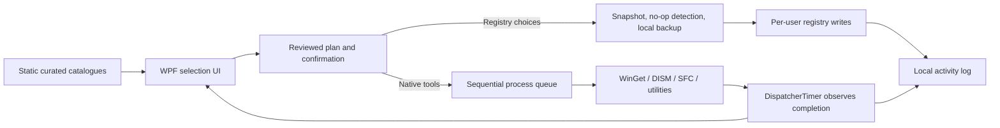

# Marceli Win: engineering review and design decisions

_Reviewed 18 October 2026. Scope: independently written PowerShell/WPF utility and Cloudflare distribution endpoint._

## Summary

Marceli Win remains a **developer preview**. It uses Windows PowerShell 5.1, a WPF UI, and a single-file distribution format to retain the review-first `irm ... -OutFile` workflow. This build prioritises a predictable task lifecycle, explicit user consent, no telemetry, and reversible settings over aggressive or dangerous Windows optimisation claims.

The revised release uses a **sequential, non-blocking external-process queue** for approved WinGet installations, DISM/SFC/CHKDSK, package upgrades, network maintenance actions and manual restore-point creation. It does not promise that cancelling the queue can stop installers already running in their own processes.

## Evidence-led engineering findings

| Principle | Source | Implementation / status |
| --- | --- | --- |
| WPF objects belong to the thread that created them; expensive work must not block the dispatcher. | [WPF threading model](https://learn.microsoft.com/en-us/dotnet/desktop/wpf/advanced/threading-model) | External operations launch with `Start-Process -PassThru` and **without** `-Wait`. A WPF `DispatcherTimer` polls exit codes and updates UI on the same dispatcher thread. |
| WPF event handlers should return quickly and handle longer operations asynchronously. | [Microsoft: keep UI responsive](https://learn.microsoft.com/en-us/windows/apps/develop/performance/keep-ui-thread-responsive) | The queue starts external processes promptly, displays the active operation and pending count, and offers a safe `Stop after current` action. |
| A `DispatcherTimer` runs on the UI dispatcher and is not a high-precision timer. | [DispatcherTimer](https://learn.microsoft.com/en-us/dotnet/api/system.windows.threading.dispatchertimer) | The timer polls every 300 ms; completion timings are informational, not precise measurement. |
| WPF separates application state from presentation through binding/MVVM. | [Windows MVVM design guidance](https://learn.microsoft.com/en-us/windows/apps/develop/data-binding/data-binding-and-mvvm) | Current small-scale approach centralises the process queue and selection state. **Remaining work:** separate XAML, view models, catalogue and command engine into testable modules before the app grows further. |
| WinGet should use explicit package ID and exact match; sources may be specified. | [WinGet install](https://learn.microsoft.com/en-us/windows/package-manager/winget/install) | App selections use hardcoded IDs and `winget install --id ... --exact --source winget`. We don't disable hash verification or bypass malware checks. The package licence agreement remains a native installer step. |
| Static analysis improves PowerShell reliability but cannot replace runtime testing. | [PSScriptAnalyzer](https://learn.microsoft.com/en-us/powershell/utility-modules/psscriptanalyzer/overview) | The Windows CI parses the script, exercises safe previews and WPF loading, validates preset selection, launches a harmless child process and invokes the actual public `irm | iex` route in a no-op smoke mode. A full rule-gated PSScriptAnalyzer review remains to be added. |
| Follow Windows accessibility preferences for client area animations. | [SystemParameters.ClientAreaAnimation](https://learn.microsoft.com/en-us/dotnet/api/system.windows.systemparameters.clientareaanimation) | WPF motion follows client-area animation / high-contrast settings and has a user toggle. The website respects `prefers-reduced-motion`. |
| Execution policy is defence in depth, not a security boundary. | [PowerShell execution policies](https://learn.microsoft.com/en-us/powershell/module/microsoft.powershell.core/about/about_execution_policies) | Avoid asking users to change execution policy globally. Prefer downloading, reviewing, and executing a pinned source file. A signed installer/script remains an important production gate. |

## Source design and boundaries

**Security boundaries:** imported JSON profiles supply **only allowlisted app/tweak identifiers**. They cannot supply arbitrary executables or command text. Restoring registry backups rejects entries outside the known tweak path/key catalogue. Changes never happen when picking a preset.

**Registry type safety:** before a change, retain whether the value existed, the previous value and RegistryValueKind. For instance, `MouseTrails` is a string-valued setting, not a DWORD. Skip unchanged values; save a backup before any modifications. Failures remain logged for follow-up.

**Local data:** `%LOCALAPPDATA%\MarceliWin\` holds logs and backups. Current implementation rotates `activity.log` at 5 MiB and trims the on-screen text. Reports and profiles are exported to a location the user selects.

**Task stopping:** `Stop after current` clears queued items but deliberately leaves a running installer alone. Closing the application warns that an external process might continue. There is no installer-process-tree cancellation yet.

**Versioned distribution:** Cloudflare Worker routes `/win` to a **commit-pinned GitHub file** and serves the animated website. The launcher response is non-cacheable, and CI confirms live bytes exactly match its pin. No secondary script downloads are made by the application.

## Real-world acceptance gates for a stable release

- [ ] Manual WPF interaction and resize testing on Windows 10 and Windows 11 (including different DPI and multiple monitors).
- [ ] Validate package IDs against live WinGet repositories; confirm licence/UAC behaviour and success/error handling.
- [ ] Test installer queue, stop-after-current, shutdown warnings and failure recovery with real package installers.
- [ ] Test backup + undo for every supported registry value, including absent values and original non-DWORD types.
- [ ] System Protection disabled/enabled; standard vs elevated user; Defender / restricted corporate policies.
- [ ] Keyboard-only navigation, screen readers, Windows high contrast, zoom and reduced motion.
- [ ] Host PowerShell 5.1 vs PowerShell 7, custom execution policy, UTF-8, unusual language/locales, offline mode.
- [ ] PSScriptAnalyzer review, dependency review, and independent security review.
- [ ] Digitally signed releases, SHA-256 checksums, release provenance/attestation and update/rollback strategy.
- [ ] Visual and functional review of every tab; all operations should show progress and useful failure feedback.

## Recommended future architecture

The present single-file script is good for an easily audited preview, but is not an ideal permanent 70+ KiB codebase.

A maintainable PowerShell version would have:
- `src/Core`: catalogues and registry plan/read/write/undo functions; no WPF dependency.
- `src/Tasks`: process queue, native command allowlist and diagnostics.
- `src/UI`: XAML, view-model state and event handling.
- `tests`: Pester unit tests using registry/process mocks, Windows WPF smoke tests and accessibility checks.
- A reproducible build that bundles reviewed source into one standalone `MarceliWin.ps1` for the hosted launcher, plus a verifiable build manifest.

If this product progresses beyond a utility script, a compiled **signed .NET WPF or WinUI desktop frontend** using PowerShell only as a privileged automation backend should be considered. Merely wrapping a PowerShell script as an `.exe` is not the same as producing a trusted, signed native desktop application.

## Explicit limitations

This refactor does **not** imply the utility is fully production-ready, universally compatible or guaranteed to speed up Windows. It does not disable Defender, UAC, automatic security updates, anti-cheat, or essential services. Individual Windows preference keys and Settings URIs can vary across Windows releases, and an installer may still require elevation or manual licence acceptance.

The current CI is a smoke test and cannot prove correctness of state-changing operations across user machines.
